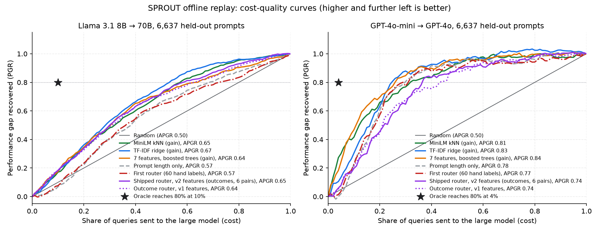

# Adaptive LLM Router

[](https://github.com/RachitSethi2455/cost-aware-model-router/actions/workflows/ci.yml)

Most LLM requests don't need the most expensive model. This project routes
each request to a cheap or an expensive model, computes exact answers in a
sandbox instead of letting the small model guess, and reports every result
with its sample size and a 95% interval.

**Live demo: [cost-aware-model-router.vercel.app](https://cost-aware-model-router.vercel.app).**
Type any question and see which model the router picks, and why. The public
demo shows routing decisions and recorded answers and makes no model calls,
so it is free to use.

## Results in brief

- **Exact answers:** for maths and counting questions the small model writes
  code that a sandbox computes, instead of guessing: **23/40 → 40/40** correct.
- **Offline, 6,637 graded prompts per model pair:** a router trained on real
  outcomes beat my first, hand-labelled router on **5 of 6** model pairs it
  never saw (APGR 0.645 vs 0.597; random routing scores 0.5).
- **Live, 200 code-checked questions on a new model pair:** **no router beat
  random routing**, because which questions gain from the big model depends on
  the pair.
- **Trained on 300 of that pair's own outcomes**, the router moved from below
  random (0.475) to above it (0.525): a real gain, not yet a clear win.
- **Production pieces:** an OpenAI-compatible API with streaming, spending
  guardrails, Prometheus metrics, a per-request decision log, and a free demo
  that makes no model calls.

Every number comes from a script in `evals/` and a results file in
`results/`, with its sample size and a 95% interval. Click a section's
"details" to see the evidence.

<details>
<summary>At a glance: each result with its caveats (<code>python evals/report_stats.py</code> reproduces every interval)</summary>

- **Exact answers, computed instead of guessed: the clearest result.** For
  arithmetic, counting letters, primality and similar questions, the small
  model writes a Python expression that a sandboxed evaluator computes. On 40
  fresh held-out questions it went from **23/40 to 40/40** correct (95%
  intervals 42–71% vs 91–100%), and from 18/40 to 40/40 on rewrites written by
  a model rather than by me.
- **Live cost result, on a small sample.** On 14 questions with Gemini
  models, routing cut cost **36–76%** against always using the large model
  (intervals 9–64% and 54–91%) while keeping **93–96%** of its answer quality,
  and cut median latency from 12.1 s to 5–8 s. The caveat matters: a random
  router sending the same share of questions to the large model would score
  within those intervals. Fourteen questions can only detect differences of
  about 25 points, so this sample cannot show the routers beat random routing;
  see [Results](#results). These were this project's first routers.
- **A router trained on outcomes, tested on model pairs it never saw.** The
  first router learned from my 60 labels of how hard a question *looks*.
  Replayed on SPROUT, a public dataset where 13 models answered the same
  44,241 prompts and every answer was graded, it did no better than routing
  by prompt length. The router now shipped learns from those graded outcomes
  instead, across six pairs of small and large models. Trained on five pairs
  and tested on the sixth, it beat the first router on **5 of 6** pairs
  (mean APGR 0.645 vs 0.597, where random routing scores 0.5), and by more
  on short questions like this service's. It still sits far below a perfect
  router, and it lost on the pair where the two models were closest. See
  [the router now shipped](#the-router-now-shipped-trained-on-outcomes).
- **Live, it does not beat random routing.** On 200 held-out questions with
  real calls and every answer checked by code (no AI grader), with a model
  pair where routing matters (allam-2-7b 20.5% vs gpt-oss-120b 82.5%), no
  router did better than random routing at the same spend. The router then
  shipped did 4.8 points worse: it treated each line of a multiple-choice
  question as a sentence and sent those to the large model, while the large
  model helped more on maths. Version 2, rebuilt to ignore formatting, is
  2.5 points worse; which kinds of question gain most depends on the model
  pair. Trained on 300 of that pair's own outcomes, it moved from below
  random routing (APGR 0.475) to above it (0.525), a significant gain over
  the shipped router but not yet reliably above random. The run also
  caught three bugs, now fixed. See
  [the live test](#live-test-200-questions-graded-by-exact-match) and
  [the own-traffic experiment](#does-it-work-an-experiment-on-the-live-pair).
- **What the offline evaluation found** (6,637 held-out prompts, no API
  cost; [details](#offline-evaluation-on-sprout-6637-graded-prompts-0)):
  - Training on *how much* the large model helps beats training on
    *whether* it helps.
  - On familiar kinds of prompt, a bag-of-words model trained that way is
    the best router: it recovers 80% of the quality gap with 54% of queries
    on the large model, where random routing needs 80%.
  - On a kind of prompt it never saw, no router reliably beats prompt length.
- **Safety net:** a deterministic check retries a cheap answer on the large
  model when it is empty, refused, cut off, hedging or missing requested code.
  It cannot catch an answer that is confidently wrong, and in the live runs
  routing, not escalation, did all the quality protection.
- **Drop-in for existing apps:** an OpenAI-compatible endpoint, so any
  OpenAI client can use the router by changing its base URL and sending
  `model="auto"`.
- **Engineering:** FastAPI service with a free interactive demo page, 7
  provider presets (Anthropic, OpenAI, Gemini, Groq, DeepSeek, OpenRouter,
  local), response cache, cost accounting, streaming on the OpenAI-compatible
  endpoint, spending guardrails (a per-client cap on large-model calls and a
  daily spend limit), a Prometheus `/metrics` endpoint and a per-request
  decision log, opt-in logging of both models' answers to learn from your
  own traffic, Docker / Render / Vercel configs, and an offline test suite
  plus lint in CI.

</details>

## How it works

Per-request model selection for LLM applications. Predicts how much a large
model would improve the answer to each query, dispatches to a small or large
model accordingly, and escalates automatically when the small model's answer
fails a set of deterministic quality checks.

Built to answer a question most LLM projects skip: **how much of your inference
bill is spent on requests that never needed the expensive model?**

```
                      ┌──────────────────┐
   query ────────────▶│ feature extract  │  9 interpretable features
                      └────────┬─────────┘
                               ▼
                      ┌──────────────────┐
                      │     router       │  additive model, trained on outcomes
                      └────┬────────┬────┘
              score<0.5    │        │   score≥0.5
                           ▼        ▼
              ┌────────────────┐  ┌──────────────────┐
              │  Haiku 4.5     │  │     Opus 5       │
              │  $1 / $5 MTok  │  │  $5 / $25 MTok   │
              └───────┬────────┘  └────────┬─────────┘
                      ▼                    │
             ┌──────────────────┐          │
             │ escalation check │          │
             │ (deterministic)  │          │
             └───┬──────────┬───┘          │
              ok │          │ fail         │
                 │          └──────────────┤ retry on large
                 ▼                         ▼
                    response + cost metadata
```

## Design decisions

<details>
<summary>Why it is built this way</summary>

**Escalation checks are deterministic, not a second LLM call.** Asking a model
to grade its own answer costs roughly what calling the large model costs, which
defeats the purpose, and self-assessment is unreliable. Instead the pipeline
checks structural signals: empty output, refusal `stop_reason`, truncation at
the token ceiling, hedging language, and "code was requested but no code came
back." These catch most real failures for free.

**Routing wrong is survivable if you can detect it.** The escalation path means
a misroute costs latency and one extra call, not a wrong answer. This is why
the router can be aggressive about sending traffic to the small model.

**Seven interpretable features, no embeddings.** An embedding call would cost as
much as the routing decision saves. The first router was a logistic
regression over them, trained on my labels; on recorded outcomes it did no
better than prompt length. The router now shipped keeps the same features
but is an *additive* model: boosted trees where each tree looks at one
feature, so the prediction is a sum of per-feature step functions. That
keeps every decision exactly explainable (the demo shows each feature's
share) and ships as an 8 KB JSON file read with plain Python: no pickle and
no scikit-learn at request time. A local bag-of-words model did better on
familiar prompts, but fell apart on unfamiliar ones and would ship pieces of
the training prompts inside its vocabulary.

**Tested on model pairs it never saw.** The service runs on Gemini, which
SPROUT does not include, so the router will always serve a pair it was not
trained on. Each of six model pairs is held out in turn and the router
trained on the other five is tested on it; that is the number that matters
here. The shipped router is trained on the average gain over all six.
Pooling turned out to matter little: a router trained on one pair's
outcomes transferred about as well.

**Types are separated from the SDK** (`router/types.py`), so all deterministic
logic is importable and testable without the `anthropic` package or an API key.
CI runs the full offline suite on every push.

</details>

## Results

<details>
<summary>The 14-question live Gemini run, and the first router's accuracy</summary>

These live results are for the first two routers: the hand-written
heuristic and the classifier trained on my labels. The router now shipped
came later and has not been run live; replayed on the same recorded answers,
it is the third row of the interval table below.

Four arms, all through identical pipeline code so the comparison isn't
confounded. **Live run on 14 questions**, `gemini-free` preset (small
`gemini-3.1-flash-lite`, large `gemini-3.6-flash`, judge `gemini-3.5-flash`),
6–7 Oct 2026. The questions are 4 from each category of the eval set
(lookup/format, reasoning/code, complex, adversarial); 2 of the planned 16
were dropped because the free tier's overload errors never let the large
model produce a reference answer. The full 60-question run needs a paid key.
Raw results: [`results/benchmark_gemini_free16.json`](results/benchmark_gemini_free16.json).

| Arm | Quality | $/100 req | p50 latency | % routed small |
|---|---|---|---|---|
| All small | 0.893 | $0.086 | 4.5 s | 100% |
| All large | 1.000 (reference) | $0.843 | 12.1 s | 0% |
| Heuristic router | 0.929 | $0.199 | 5.0 s | 86% |
| Classifier router | 0.964 | $0.543 | 8.1 s | 50% |

The same run with 95% intervals (paired bootstrap over questions) and the
standard routing references: PGR, the share of the small-to-large quality gap
a router recovers, and a random router that sends the same share of questions
to the large model, which scores PGR equal to that share
([RouteLLM](https://arxiv.org/abs/2406.18665)). Reproduce with
`python evals/report_stats.py`.

| Router | Quality | Retention | Cost reduction | Random router at same share | Gain over random | PGR (random) |
|---|---|---|---|---|---|---|
| Heuristic | 0.929 [0.82, 1.00] | 93% [82, 100] | 76% [54, 91] | 0.908 | +0.020 [−0.015, +0.069] | 0.33 (0.14) |
| Classifier | 0.964 [0.89, 1.00] | 96% [89, 100] | 36% [9, 64] | 0.946 | +0.018 [−0.036, +0.069] | 0.67 (0.50) |
| Outcome router v1, replayed | 0.929 [0.82, 1.00] | 93% [82, 100] | 82% [62, 92] | 0.901 | +0.028 [0.000, +0.077] | 0.33 (0.07) |
| Outcome router v2 (shipped), replayed | 0.893 [0.79, 1.00] | 89% [79, 100] | 86% [75, 91] | 0.901 | −0.008 [−0.031, 0.000] | 0.00 (0.07) |

*Replayed* means each question takes the recorded small- or large-model
answer, whichever the router now picks; no model was called.

- Version 1 sends only the bug-fix question (m04) to the large model, one
  of the three where the small model fell short, and keeps the heuristic's
  quality at a lower cost.
- Version 2 sends only the arithmetic question, which the calculator
  answers in the service anyway, so it keeps just the small model's
  quality.

On 14 questions none of this is distinguishable.

Read honestly: both routers save real money against always-large, but their
quality gain over a random router at the same spend is about two points with
an interval that includes zero. Fourteen questions cannot separate either
router from random routing, or the two routers from each other; that takes
hundreds of questions (about 1,000 to detect a three-point difference). Costs
are at paid-tier rates; latency is each model call as originally measured.
"Quality" is judged by `gemini-3.5-flash` against the large model's own
answer, so it measures agreement with the large model, not correctness, and a
judge from the same family as the graded models may favour them.

What the 14 questions show:

- **Where the quality goes.** The small model fell short on 3 of 14: a
  reasoning explanation (m01), a subtle bug fix (m04) and an exhaustive list
  (a03). The classifier sent 2 of those 3 to the large model, the heuristic
  only 1; that is the whole quality difference between them.
- **What the classifier's caution costs.** It also sent 4 questions to the
  large model that the small model answered fully. Its labels say how hard a
  question *looks*, which overestimates what this small model needs.
  Relabelling from observed outcomes (`train_router.py --from-benchmark`)
  is the fix, once the full 60-question run exists.
- **Routing pays even with a small price gap.** The large model's list price is
  about 3x the small one's, but it cost about 10x more per request because it
  writes far more (hidden reasoning) tokens. Output volume drives cost more
  than the price list does.
- **Escalation never fired.** All the quality protection came from routing.
  On "List the countries that border exactly three other countries" the small
  model returned a confident but incomplete list; structural checks (empty,
  refused, truncated, hedging) cannot see a wrong answer that looks complete.
  This is limitation 5, observed live.

A first run on 9 of these questions
([`results/benchmark_gemini_free_n9.json`](results/benchmark_gemini_free_n9.json))
had the heuristic ahead and the 14-question run has the classifier ahead on
quality. That flip is itself the lesson: at this sample size the ordering is
noise.

**The first router's accuracy against my labels (offline, no API calls;
`python evals/analyze_router.py`):**

This part, down to the feature weights, describes the first router, trained
on my labels. On recorded outcomes it did no better than prompt length, and
the outcome-trained router replaced it; it is kept as `mode="classifier"`
for comparison.

Accuracy here means agreement with my own 60 difficulty labels (33 "needs the
large model", 27 "small is enough"; always guessing the majority scores 55%),
not whether the small model actually succeeded. See limitation 6.

| Model | Accuracy, random splits | Accuracy, unseen category | AUC | Brier (lower is better) |
|---|---|---|---|---|
| Majority class | 55.0% | 26.7% | 0.500 (no ranking) | 0.248 |
| Heuristic rules | 56.7% | 56.7% | 0.811 | n/a (scores, not probabilities) |
| TF-IDF + logistic regression (bag of words) | 79.8% ± 3.7 | 60.0% | 0.870 ± 0.018 | 0.219 ± 0.002 |
| **Router: 7 features + logistic regression** | **78.2% ± 3.8** | **73.3%** | 0.833 ± 0.012 | **0.152 ± 0.011** |

*Random splits* are out-of-fold predictions from 20 reshuffled stratified
5-fold splits (± is the spread across the 20 repeats). *Unseen category*
trains on 12 of the 13 question categories and tests on the one left out.

**Why hand-made features rather than bag-of-words.** On random splits the
two are tied: similar phrasings land in both train and test, and TF-IDF
ranks slightly better. Hold out a whole category and TF-IDF drops to 60%: it
had learned each category's topic words rather than difficulty, and on unseen
easy categories it collapses (lookups 1/9 correct, formatting 2/6,
classification 1/4, against the router's 5/9, 6/6 and 4/4). The router's
probabilities are also better calibrated (Brier 0.152 vs 0.219), which
matters because it acts on a probability threshold. Both fail on the
adversarial categories; see limitation 5.

The rule-based heuristic ranks queries reasonably (AUC 0.81); its 56.7%
accuracy comes from a badly placed cut-off rather than bad signals.

**Threshold trade-off** (router, out-of-fold, mean over repeats):

| Threshold | Routed to small | Hard queries sent to small | Easy queries sent to large |
|---|---|---|---|
| 0.3 | 33% | 13% | 42% |
| 0.4 | 41% | 22% | 35% |
| **0.5 (default)** | 51% | 26% | 17% |
| 0.6 | 57% | 29% | 8% |
| 0.7 | 61% | 32% | 4% |

A hard query sent to the small model costs an escalation round trip if the
quality checks catch the failure, and a weaker answer if they don't. An easy
query sent to the large model only costs money. Which side to favour depends
on how good escalation is in practice, which is what the live benchmark
measures.

An earlier version of this README quoted 80.0% from a single 5-fold split;
with 60 examples one split swings by several points depending on the seed,
so the repeated-CV mean is the honest figure. The 6-feature version of the
router scored 75.7% on the same protocol.

The seventh feature, `asks_for_code`, was added after live testing showed
"Write a Python function to merge two sorted lists" routed to the small model:
`has_code` only detects code pasted *into* a query, not a request *for* code.
The +2.5 point gain is within one standard deviation, and the feature was
designed after seeing the eval set, so treat it as directional.

**First router's learned feature weights** (positive pushes toward the large
model):

| Feature | Coefficient |
|---|---|
| `reasoning_marker_count` | +1.149 |
| `simple_marker_count` | −0.909 |
| `asks_for_code` | +0.711 |
| `n_constraints` | −0.664 |
| `has_code` | +0.460 |
| `n_words` | +0.316 |
| `n_sentences` | +0.309 |

</details>

## Offline evaluation on SPROUT: 6,637 graded prompts, $0

<details>
<summary>Setup, the results table and chart, and the router now shipped (versions 1 and 2)</summary>

Fourteen live questions cannot rank routers, and my 60 labels record how hard
a question looks, not what happened. [SPROUT](https://huggingface.co/datasets/CARROT-LLM-Routing/SPROUT)
(from the [CARROT paper](https://arxiv.org/abs/2502.03261)) fixes both: 13
models answered the same 44,241 prompts (chat, MMLU-Pro, MATH and others),
and each answer was graded 0–1 against a reference answer. Replaying a
router on those recorded outcomes costs nothing and measures it on outcomes.

**Setup.** Small model Llama 3.1 8B, large model Llama 3.1 70B. Routers
learn from SPROUT's train split (30,968 prompts), settings are chosen on its
validation split (6,636), and the test split (6,637) is used for reporting.
On the test split the small model averages 0.687 and the large one 0.811.
The large model scores higher on 26.6% of prompts (by 0.5 or more on 15.9%),
and the small model scores higher on 7.9%.

**Metrics** ([RouteLLM](https://arxiv.org/abs/2406.18665)'s): sort prompts by
the router's score and send the top share to the large model. *PGR* is the
share of the quality gap recovered at a given share of large-model calls.
*APGR* is the area under that curve: random routing scores 0.5, higher is
better. Intervals are 95% paired bootstrap intervals over prompts. Cost here
means the share of large-model calls, not dollars.



| Router | Trained on | APGR [95% CI] | Large calls needed for 80% of the gap |
|---|---|---|---|
| Oracle (knows every outcome) | – | 1.22 | 10% |
| TF-IDF + ridge regression | gain | **0.672** [0.654, 0.689] | **54%** |
| MiniLM sentence embeddings + ridge | gain | 0.650 [0.630, 0.670] | 59% |
| MiniLM embeddings, 100 nearest neighbours | gain | 0.647 [0.627, 0.667] | 58% |
| 7 features + boosted trees | gain | 0.640 [0.619, 0.662] | 64% |
| 7 features + linear (ridge) | gain | 0.584 [0.560, 0.606] | 68% |
| **Router now shipped** (v2: 9 format-proof features, additive; [below](#the-router-now-shipped-trained-on-outcomes)) | gain, 6 pairs | 0.647 [0.626, 0.668] | 59% |
| Outcome router v1 (the 7 features, additive) | gain, 6 pairs | 0.636 [0.616, 0.657] | 63% |
| Prompt length alone | – | 0.574 [0.552, 0.595] | 69% |
| First router (7 features, 60 hand labels) | my labels | 0.569 [0.545, 0.592] | 73% |
| MiniLM embeddings, nearest neighbours | strict label | 0.559 [0.538, 0.583] | 72% |
| 7 features + logistic regression | strict label | 0.530 [0.505, 0.556] | 86% |
| Random | – | 0.500 | 80% |

*Gain* is the large model's score minus the small model's; *strict label* is
1 whenever the large model scored higher at all. The router now shipped was
added after these comparisons, and its training included this pair's
training prompts; how it does on a pair it never saw is
[below](#the-router-now-shipped-trained-on-outcomes). Full output, including
TF-IDF and MiniLM trained on the strict label: `python evals/sprout_replay.py`.

What it shows:

1. **The first router was no better than prompt length on outcomes**
   (0.569 vs 0.574). Its 78% accuracy measured agreement with my difficulty
   labels; on what actually happened, it carried about as much signal as
   counting words. That is why it was replaced.
2. **What a router is trained on matters as much as its features.** The
   strict label treats a 0.1 wobble in the judge's score the same as a wrong
   answer turned right. Training on the size of the gain instead raised the
   nearest-neighbour router by +0.088 APGR [+0.065, +0.110] and the linear
   seven-feature router by +0.054 [+0.017, +0.088]. The usual accuracy-style
   metric hides this: on the strict label, the gain-trained text and
   embedding routers have *lower* AUROC (0.52–0.53 vs 0.59–0.60) while
   recovering much more quality. On the GPT-4o pair below, the effect is
   smaller and not significant.
3. **The seven features carry signal, but not in a straight line.** Boosted
   trees on the same seven numbers reach 0.640, near the embedding routers;
   a linear model on them is no better than length (+0.010 [−0.016, +0.036]).
4. **On familiar kinds of prompt, a bag-of-words model wins.** TF-IDF with
   ridge regression is the best router here, ahead of MiniLM nearest
   neighbours by +0.025 [+0.006, +0.040], and it needs no embedding model or
   API call.
5. **Every router is far from the oracle.** The best needs 54% of queries on
   the large model to recover 80% of the gap; an oracle needs 10%. Most of
   whether the 70B model helps on a given prompt is not visible in the
   prompt's text, which matches the plateau published routers report.

**A kind of prompt the router never saw.** The test above shares sources
with the training data, which suits anything that learns topic words. The
README's earlier argument for hand-made features was that they generalise:
on 60 queries, bag-of-words fell from 80% to 60% on unseen categories while
the features held 73%. `evals/sprout_unseen_source.py` tests that on
outcomes by holding out a whole source: train on every other source, test on
the held-out one. APGR on the held-out source, with the same router's score
when that source *was* in training in brackets (intervals are about ±0.04):

| Held-out source (test prompts) | TF-IDF ridge | MiniLM neighbours | 7 features, trees | 7 features, additive (shipped design) | Prompt length | First router |
|---|---|---|---|---|---|---|
| Chat, OpenHermes (2,912) | 0.590 (0.720) | **0.600** (0.708) | 0.578 (0.627) | 0.563 | 0.554 | 0.467 |
| MMLU-Pro (1,772) | 0.509 (0.526) | 0.509 (0.523) | 0.533 (0.533) | **0.538** | 0.482 | 0.479 |
| MATH (1,462) | 0.478 (0.625) | 0.514 (0.587) | 0.544 (0.604) | 0.552 | 0.581 | **0.595** |

- Every learned router loses most of its edge on a source it never saw.
  TF-IDF falls furthest: on MATH it drops from 0.625 to 0.478, below random,
  the same failure the 60-query test found. The seven features (trees) beat
  it there by +0.066 [+0.016, +0.117], but not on chat (−0.012 [−0.064, +0.042]).
- No learned router reliably beats prompt length on an unseen source. The
  GPT-4o pair has one source with a usable gap (MMLU-Pro); held out, prompt
  length did best there (0.648), TF-IDF beat the seven features with trees
  by 0.101 [0.033, 0.169], and the additive version fell below random
  (0.422), so the features' edge on MATH does not generalise.
- MMLU-Pro is close to random for every router, seen or unseen: whether the
  8B model knows a multiple-choice fact does not show in the question.
  RouteLLM likewise found its chat-trained routers near random on MMLU.

**Second pair, GPT-4o-mini → GPT-4o.** The two are only 4 points apart
(0.807 vs 0.848) and the small model scores higher on 9.1% of prompts, so
intervals are about ±0.06 wide. The order at the top is similar (MiniLM +
features 0.876, MiniLM ridge 0.867, 7 features with trees 0.839, TF-IDF
0.826), the first router again sits with prompt length (0.772 vs 0.781),
and most differences are not significant. The router now shipped scores
0.742 [0.694, 0.798] here (version 1: 0.738), below both, even though its
training included this pair. On two of its three sources the
gap is under 0.01, so per-source results are skipped there.

### The router now shipped: trained on outcomes

These results replaced the deployed router. The new one
(`evals/train_outcome_router.py`, `src/router/outcome.py`) keeps the seven
features and changes what they are trained on and how:

- **Target:** the gain (large grade minus small grade), averaged over six
  pairs of small and large models in SPROUT, no model in two pairs.
- **Model:** boosted trees in which each tree uses one feature, so the
  prediction is a sum of per-feature step functions and every decision is
  exactly explainable. The restriction costs little: on the Llama test
  split version 1 scores 0.636, against 0.640 for unrestricted boosted
  trees on the same features.
- **Shipping:** the step functions are an 8 KB JSON file read with plain
  Python. Before it is written, the export is checked against the trained
  model on all 44,241 prompts.
- **Score:** the percentile of a question's predicted gain among SPROUT's
  validation prompts, so the default threshold of 0.5 sends about half of
  that traffic to the large model.

**Tested on a pair it never saw** (version 1 features; version 2 below). The service runs on Gemini, which SPROUT
does not have, so each pair in turn is held out: train on the other five,
choose settings on validation, test on the held-out pair's 6,637 test
prompts.

| Held-out pair | Quality gap | Outcome router, pair unseen [95% CI] | Trained on this pair | Trained on Llama 8B→70B only | First router | Prompt length |
|---|---|---|---|---|---|---|
| Llama 3.1 8B → 70B | 0.124 | 0.635 [0.615, 0.656] | 0.627 | 0.627 | 0.569 | 0.574 |
| GPT-4o-mini → GPT-4o | 0.041 | 0.710 [0.659, 0.760] | 0.814 | 0.712 | **0.772** | **0.781** |
| Granite 3 2B → 8B | 0.105 | 0.588 [0.562, 0.614] | 0.615 | 0.576 | 0.515 | 0.518 |
| Llama 3.2 3B → 3.3 70B | 0.171 | 0.675 [0.659, 0.693] | 0.672 | 0.666 | 0.602 | 0.615 |
| Llama 3.2 1B → 3 405B | 0.313 | 0.625 [0.615, 0.638] | 0.636 | 0.631 | 0.580 | 0.598 |
| Mixtral 8x7B → Claude 3.5 Sonnet | 0.210 | 0.598 [0.585, 0.612] | 0.633 | 0.591 | 0.543 | 0.534 |

- On 5 of 6 unseen pairs it beats the first router, by +0.046 to +0.073
  APGR with every interval above zero. The mean over the six is 0.639,
  against 0.597 for the first router and 0.603 for prompt length.
- The exception is GPT-4o-mini → GPT-4o, the two closest models: it loses
  there by 0.062 [0.005, 0.129], and prompt length does best.
- Outcomes from the pair itself help most where pooling misses: GPT-4o
  (0.814 vs 0.710) and Mixtral → Claude (0.633 vs 0.598). On the other
  four, the router that never saw the pair is within 0.03 of it.
- How many pairs it learns from matters little. Trained on Llama 8B → 70B
  alone, it transfers about as well as trained on five pairs: within 0.012
  APGR on every other pair. Most of the gain over the first router comes
  from training on outcomes at all.
- On short questions like this service's (at most 60 words and 3
  sentences; 3,385 test prompts), the first router is close to random
  (0.50–0.53). The outcome router, pair still unseen, beats it by +0.09 to
  +0.19 on every pair with a usable gap, every interval above zero.

**What version 1 learned** (the numbers above): mostly sentence count.
One-sentence prompts had the smallest expected gain from the large model
(−0.08 against the average of 0.16), and three to about thirty sentences
the largest (+0.03 to +0.06). Reasoning words such as "explain", which the
first router relied on most, barely mattered. Because every line counted as
a sentence, version 1 was easy to steer by formatting. The live test then
showed it misrouting honest traffic the same way, so it was replaced.

#### Version 2: features that ignore formatting (now shipped)

The [live test](#live-test-200-questions-graded-by-exact-match) showed
version 1 reading formatting as difficulty. It counted each line as a
sentence, so a multiple-choice question with its options on separate lines
looked like a long multi-part task. It also took LaTeX braces for code.

Version 2 (`extract_v2` in `src/router/features.py`) fixes this:

- It counts sentences by punctuation only.
- It skips answer options, whether on their own lines or inline.
- It ignores LaTeX when looking for code.
- It adds two features naming the kind of question: multiple choice, and
  maths.

Training is otherwise the same. The first router keeps the original
features, so its documented results stay reproducible, and version 1 is
kept frozen in `evals/models/` for comparison.

| Test | Version 1 | Version 2 |
|---|---|---|
| Mean APGR, each of 6 model pairs held out | 0.639 | **0.645** |
| A held-out kind of prompt: chat / MMLU-Pro / MATH | 0.581 / 0.501 / 0.522 | 0.550 / 0.509 / 0.505 |
| Live (allam-2-7b → gpt-oss-120b): gain over random at the same share | −0.048 [−0.075, −0.019] | −0.025 [−0.047, −0.003] |
| Live, same pair: accuracy; share sent to the large model | 61.0%; 73% | 71.0%; 85% |
| "What is the capital of Japan?" plus a greeting and one more sentence | 0.74, large | 0.34, small |
| The same question plus an empty code block | 0.97, large | 0.32, small |

- **On familiar kinds of prompt, version 2 is slightly better.** It is
  better on 3 of the 6 held-out pairs, about the same on 2, and slightly
  worse on 1; no difference is large.
- **On a kind of prompt it never saw, it does not help.** It is slightly
  worse on chat and maths, and prompt length is still as good as any
  router there (0.598 / 0.519 / 0.553).
- **Live, it is less wrong but still worse than random routing.** It no
  longer mistakes option lines for sentences. But it learned from SPROUT
  that multiple-choice questions gain a lot from a bigger model, so it
  still sends 97 of 100 of them to the large one, and 72 of 100 maths
  problems. On this pair the large model gained more on maths. Which kind
  of question gains most depends on the model pair, and no router can know
  that without outcomes from that pair; [logging your own
  traffic](#learning-from-your-own-traffic) collects them.
- **What version 2 learned:** whether the question is maths (+0.058 vs
  −0.022) or multiple choice (+0.044 vs −0.018), and length (short prompts
  −0.06, long ones up to +0.06). Sentence count barely matters any more.
  Its stricter code detection rarely fires on SPROUT, so code now has no
  effect: the bug-fix question from the 14-question run, which version 1
  sent to the large model, now stays on the small one.
- **For this service it is even more cautious.** It sends 2 of the 60
  eval-set questions to the large model (version 1: 8; first router: 25).
  Replayed on the 14 recorded live answers, it keeps only the small
  model's quality (0.893, 86% cheaper), where version 1 kept 0.929.
  Fourteen questions cannot separate the two. Lower `ROUTE_THRESHOLD` if
  you see too few large-model calls.

**Caveats for this whole section.**

- SPROUT's grades come from an LLM judge (Llama 3.1 70B, per the CARROT
  paper) comparing each answer to a reference. That is the same model as
  the large side of the main pair, and judges can favour their own answers.
- These are different models from the Gemini pair the service uses, so the
  numbers rank routing *methods*; they are not a prediction for Gemini.
- I first ran every router on the strict label, the usual setup, and looked
  at those test results. Switching to the gain was decided on validation
  data, and both versions are reported.
- The dataset card states no licence, so the data is downloaded by the
  script for evaluation and not redistributed here.

Reproduce (about 550 MB of data; embedding the prompts took about 50
minutes once on a laptop CPU and is cached, then each run takes a few
minutes):

```bash
pip install -r requirements-eval.txt
python evals/sprout_replay.py --pair llama        # prints download commands if data/sprout is empty
python evals/sprout_replay.py --pair gpt4o
python evals/sprout_unseen_source.py --pair llama
python scripts/sprout_chart.py
```

</details>

## Live test: 200 questions, graded by exact match

<details>
<summary>Both model pairs, every router against random routing, and the three bugs it caught</summary>

The 14-question Gemini run could not rank routers, and an LLM from the same
family graded it. This run fixes both. It used 200 questions from SPROUT's
held-out test split: 100 MMLU-Pro multiple-choice questions and 100 MATH
problems whose answer is a plain number or fraction. Every answer was checked
by code (`evals/exact_match.py`), with real calls on Groq's free tier on
13–14 October 2026. Both models answered every question once; each router was
then replayed on those answers, applying escalation as the pipeline does.
`python evals/live_exact_benchmark.py --report results/live_exact_groq-allam.json`
recomputes every number below from the committed answers, with no API key.

| Model pair | Small model alone | Large model alone | Large right, small wrong | Small right, large wrong |
|---|---|---|---|---|
| allam-2-7b → gpt-oss-120b | 20.5% [15.0, 26.5] | 82.5% [77.0, 88.0] | 132 questions | 8 |
| gpt-oss-20b → gpt-oss-120b | 80.5% [74.5, 86.0] | 82.5% [77.0, 88.0] | 8 questions | 4 |

**allam-2-7b → gpt-oss-120b**, where routing matters:

| Router | Accuracy [95% CI] | Questions answered by the large model | Cost saved vs always-large [95% CI] | Gain over random routing at the same share [95% CI] |
|---|---|---|---|---|
| Outcome router v1 (shipped at the time) | 61.0% [54.0, 67.5] | 73% | 14% [10, 20] | **−0.048** [−0.075, −0.019] |
| Outcome router v2 (now shipped; re-scored once on the same answers) | 71.0% [65.0, 77.0] | 86% | 7% [4, 10] | −0.025 [−0.047, −0.003] |
| First router | 67.5% [61.0, 73.5] | 82% | 11% [7, 16] | −0.035 [−0.059, −0.010] |
| Heuristic | 35.0% [28.5, 41.5] | 28% | 62% [52, 72] | −0.029 [−0.067, +0.007] |

On the routing curve (APGR; random routing scores 0.5), version 1 scores
0.463 [0.427, 0.496], version 2 0.475 [0.440, 0.508], the first router
0.447, the heuristic 0.458 and prompt length 0.444. A router that knew the
outcomes would score 0.71. Version 2 was designed after this test showed
version 1's flaw, so its row is not an independent test; it was scored once,
from the cached answers (`results/live_exact_groq-allam_v2.json`).

- **No router beats random routing here.** Version 1 did measurably worse:
  at the share of questions it sent to the large model, random routing
  would have scored 4.8 points higher. Version 2 is 2.5 points worse.
- **The reason is the weakness in limitation 10.** Version 1 counts lines
  as sentences, so it sent 97 of the 100 multiple-choice questions to the
  large model (each answer option sits on its own line) and only 47 of the
  100 maths problems. But the large model helped on 74 maths problems and 58
  multiple-choice ones, so the formatting cue pointed the wrong way. This is
  the offline finding seen live: on a kind of prompt it did not learn from,
  the router does not transfer. Version 2 ignores the formatting, but it
  learned from SPROUT that multiple choice gains a lot, so it still sends 97
  of those questions to the large model (and 72 maths problems).
- **With a small model this weak, the right policy is not to route.** The
  large model wins on two thirds of the questions.

**gpt-oss-20b → gpt-oss-120b**, two models 2 points apart:

- Every router reaches the large model's 82.5%, while sending 26–82% of
  questions to it and saving 7–21%.
- Using the small model alone saves 36% and loses 2 points.
- The large model was right where the small one was wrong on only 8
  questions, too few to rank routers (APGR intervals span 0.25–1.10).
- At Groq's list prices, the 200 questions cost $0.090 always-large and
  $0.057 always-small.

**What the live test caught, fixed before these numbers:**

1. The escalation check retried every answer under 20 characters. Reasoning
   models answer tersely ("Final answer: B"), so every cheap answer was
   retried on the large model, and routing cost more than always using the
   large one. It now escalates only empty answers.
2. My grader missed bare answers such as "103". That invented a 14-point
   gap between gpt-oss-20b and gpt-oss-120b; the real gap is 2 points.
3. Which maths problems were eligible depended on which reference answers
   the grader could read. Improving the grader therefore silently swapped
   questions mid-run. The question list is now frozen
   (`evals/live_exact_questions.json`).

**Caveats:**

- allam-2-7b has no published price; it is costed like Groq's 8B model.
  It has a 4K context window, so its replies were capped at 1,024 tokens,
  and 8 of them were cut off.
- Each question was asked once, at the default temperature.
- The question mix is half multiple choice and half maths, not chat
  traffic.

</details>

## Known limitations

Written up deliberately — these are the interesting parts.

1. **The heuristic baseline is weak (56.7%, barely above majority class).** It
   systematically under-routes: long complex queries that lack literal marker
   words like "explain" or "compare" slip through as simple. The classifier's
   advantage is partly that it learns length and sentence structure matter, not
   just keywords. A stronger hand-tuned baseline would narrow the gap.

2. **`n_constraints` has a negative coefficient, which is counterintuitive.**
   Bullet-point structure was expected to signal difficulty; instead the model
   learned it correlates with well-specified, mechanically answerable requests.
   Small-sample artifacts are also plausible at n=60.

3. **Quality is measured relative to the large model, not absolute truth.** The
   judge grades candidates against the large model's own answer, so the
   all-large arm scores 1.00 by construction. This measures *quality retention
   under routing*, not correctness. A human-labeled subset would be needed for
   the latter.

4. **The eval set is small (60 queries) and hand-written by one person.** CV
   standard deviation is wide. Numbers are directional, not precise.

5. **Adversarial "simple-looking" queries are the dominant failure mode.**
   Arithmetic, letter-counting, and one-word ambiguous prompts look trivial by
   every surface feature but need the large model. Surface features cannot fix
   this; it needs either a semantic signal or an accepted escalation cost.
   The next section measures how often the small model fails these silently,
   and what a rule-based fix does and doesn't catch.

6. **The router is trained on other models' outcomes, not this service's.**
   The first router learned from my judgement of how hard 60 questions look;
   on SPROUT's outcomes it did no better than prompt length, so it was
   replaced by one trained on graded outcomes. Those outcomes come from six
   other model pairs, though, not the Gemini pair the service calls. The
   router was tested on pairs it never saw, and in the live test on a pair
   it never saw, it did worse than random routing. The fix that would settle
   it is to log both models' answers on a sample of real traffic and train
   on that. The service can now do this ([own traffic](#learning-from-your-own-traffic)).
   In an experiment with 300 of the live pair's own outcomes, it lifted the
   router from below random routing (0.475) to above it (0.525), but not
   yet reliably above it. It has not been run on real users' traffic.

7. **The live tests are small and narrow.** The 14-question Gemini run gives
   intervals about ±25 points wide, so it cannot rank routers; the Gemini
   free tier allowed about 20 requests per model per day. The 200-question
   exact-match run can rank routers on a pair with a large gap, but covers
   two Groq pairs and two kinds of question (multiple choice and maths), not
   the Gemini pair or chat traffic.

8. **The judge is from the same family as the graded models.** A Gemini model
   grades Gemini answers against a Gemini reference, and LLM judges are known
   to favour outputs like their own. The exact-answer evaluation avoids this
   by checking answers with code.

9. **The exact-answer questions are generated shapes, not real traffic.**
   They test arithmetic, counting, primality, reversal and digit sums in fixed
   templates and model-written rewrites. Real users phrase things more
   variously, and mix calculations into longer requests.

10. **Surface features can be steered.** Version 1 of the outcome router
    leaned on sentence count. Splitting a question into more sentences or
    adding a code block flipped it to the large model, and in the live test
    answer options on separate lines did the same to almost every
    multiple-choice question. Version 2 ignores line breaks, options and
    LaTeX, and those tricks no longer flip it. It can still be pushed:
    "What is the capital of Japan?" scores 0.04, and with "Think step by
    step." appended, 0.23. Published attacks on routers use exactly this
    kind of prefix; the [spending guardrails](#spending-guardrails) (a
    per-client cap on large-model calls and a daily spend limit) bound the
    cost.

11. **The offline results use other models and an LLM judge.** SPROUT's
    models are Llama, GPT-4o, Granite, Mixtral and Claude, not the Gemini
    models the service calls, and its grades come from a Llama 3.1 70B
    judge, the same model as the large side of the main pair. The replay
    ranks routing methods; it does not predict savings on Gemini.

## Silent failures: measured, then fixed with a calculator

<details>
<summary>How often small models fail without a sign, and the calculator that fixes it</summary>

Escalation can only see an answer that *looks* broken. For exact-answer
questions a small model answers fluently and confidently whether it is right
or wrong, so no structural check can tell. Two pieces address this:

- **`router/risk.py`:** five readable rules that recognise silent-failure
  question shapes: exact arithmetic, counting letters, number checks such as
  primality, reversing text, and open-world "list all X that..." questions.
  They were written after seeing four adversarial questions in the eval set.
- **`evals/exact_answer_eval.py`:** a held-out test the rules were not written
  against. Questions are generated from a fixed seed in shapes where Python
  computes the right answer, so correctness is checked by code, not by a judge
  model. Each shape is asked in its usual wording and in a paraphrase, plus one
  shape no rule targets (digit sums) and 16 harmless look-alike questions.

**Held-out results** (40 questions, seed 11, small `gemini-3.1-flash-lite`;
[`results/exact_answer_eval_seed11.json`](results/exact_answer_eval_seed11.json)):

| | |
|---|---|
| Small model wrong | **22 of 40 (55%)**, every one stated confidently |
| Rules flag the usual wording | 16 of 16 (the four covered shapes) |
| Rules flag a paraphrase | **0 of 20** |
| Failures caught by the rules | 8 of 22 |
| False alarms (27 easy eval-set queries + 16 look-alikes) | **0 of 43** |

The rules are precise but brittle: they never fire on a harmless question, and
they never recognise a rephrasing ("Multiply 407 by 62, subtract..." instead
of "407 * 62 - ..."). Pattern rules match wordings, not intent.

**What they cost on the live set.** Re-running the 14-question benchmark with
the rules on (from cache, no new API calls;
[`results/benchmark_gemini_free16_rules.json`](results/benchmark_gemini_free16_rules.json))
sends three questions (arithmetic, primality, an exhaustive list) to the
large model:

| Router | Rules off | Rules on |
|---|---|---|
| Heuristic | 93% quality, 76% cheaper | 96% quality, 50% cheaper |
| Classifier | 96% quality, 36% cheaper | 100% quality, 9% cheaper |

The cost is real: the large model reasons at length on exactly these
questions. The quality gain is partly by construction, since quality is scored
against the large model's own answer, and on two of the three questions the
small model had already matched it.

**Decision: the rules are opt-in** (`ENABLE_RISK_RULES=1`). They always
*report* a risk (`/explain` returns `risk_rules`, and the demo page shows it),
but only change routing when enabled. The missing measurement is whether the
large model answers the flagged questions correctly: the free tier's quota
allowed one check (correct). If it holds up, enabling the rules is a
quality-first setting worth its cost.

### The fix that works: compute, don't guess

For arithmetic, counting, primality, reversal and digit sums a larger model
only makes a right answer more likely. Computing it makes it right. So for
these questions (`router/tools.py`) the small model does not answer: it writes
**one Python expression**, and a locked-down evaluator computes it.

- **The evaluator is not `eval`.** It walks the expression's syntax tree and
  allows only a whitelist: literals, arithmetic, comparisons, a few builtins
  (`len`, `sum`, `any`, `is_prime`, ...), six string methods, slicing and
  simple comprehensions. No imports, no attribute access, no lambdas, no
  string formatting; limits on powers, ranges, string size, loop steps and
  total allocation. On Linux each evaluation also runs in a separate process
  with a timeout and memory/CPU limits. A regression suite replays the
  published 2026 escapes of in-process Python sandboxes (PraisonAI,
  Crawl4AI, CrewAI) and resource bombs, plus a fuzz test; see
  [SECURITY.md](SECURITY.md) for the threat model.
- **It falls back safely.** If the model says `NONE`, writes something
  outside the whitelist, or writes a literal that computes nothing (`'1174'`,
  `'LIFO' == 'LIFO'`), the router answers normally. A wrong guess wrapped in
  quotes is not treated as a computation.
- **Plain symbolic arithmetic needs no model at all.** A question that is just
  "what is / calculate" plus an expression in symbols (`557 * 65 - 2484 / 12 +
  424`) is parsed and computed directly: no call, no cost, always exact. A
  strict check keeps "Is 12 * 3 greater than 40?" or a date like
  `2026-10-07` from being mistaken for a bare calculation.
- **A trigger decides when to try it**, broader than the risk rules so it also
  catches rephrasings ("Multiply 407 by 62, ..."). Open-world lists are
  excluded: they can't be computed, and trying first cost an extra 11 s on
  the live run.

**Held-out result** (40 fresh questions, seed 19;
[`results/exact_answer_eval_seed19.json`](results/exact_answer_eval_seed19.json)):

| Small model (`gemini-3.1-flash-lite`) | Correct |
|---|---|
| Answering directly | 23 / 40 (58%) |
| Writing an expression, or parsed directly | 39 / 40 (98%) |
| **Router policy** (code when the trigger fires and code answers, else direct) | **40 / 40 (100%)** |

Paraphrased questions: direct 13/20, code 20/20, which the pattern rules
could not catch at all. The trigger fired on all 40, and on 1 of the 43
harmless questions ("What is the opposite of 'reverse' gear in a car?"), where
the model declined and the router answered normally. With the design before
this one, forced through the code path on all 43, every answer the model
produced was correct (extracting emails, 45 °C → 113 °F, 10% of 200).

**Wordings I didn't write.** The trigger and paraphrase templates were written
by the same person, so I also had the small model rewrite fresh questions in
two styles (neutral and casual chat), keeping only rewrites that preserved
every number and quoted word
([`results/exact_answer_eval_seed17_llm_paraphrase.json`](results/exact_answer_eval_seed17_llm_paraphrase.json)).
The trigger fired on all 40 rewrites. With the first design the policy got
35/40, and all five misses were arithmetic: told to "Calculate the result of
557 * 65 - ...", the model did the sum in its head and wrote a wrong number
(the quoted-guess check rejected it, but the fallback was wrong too). That is
what the direct parser fixes.

Re-run with the final design: the small model answering directly got 18/40;
with the code tool, **40/40**, every question computed rather than guessed.
Since this set is the one that exposed the mental-arithmetic problem, for its 8
arithmetic questions the re-run confirms the fix rather than testing it blind;
the other 32 questions are untouched by that change and scored 32/32.

How the design got there, and why each reported number comes from a seed
nothing was tuned on: seed 11 exposed `any`/`all` missing from the
whitelist, quoted guesses accepted as computations, and lists glued into one
string; seed 13 measured that version (38/40); seed 17's model-written
rewrites exposed mental arithmetic; seed 19 measures the final design.

**On the live set** ([`results/benchmark_gemini_free16_code.json`](results/benchmark_gemini_free16_code.json))
the tool answered the arithmetic and primality questions by code
(`17 * 24 + 3**7 - 1024 / 8` = 2467, `is_prime(1729)` = no), both correct, at
a quarter of the direct answer's cost. Quality and total cost are unchanged,
since the small model had already got those two right; median latency moved
from 5.0 s to 6.1 s (heuristic), mostly one call measured on a different day
under different load.

**The code tool is on by default** (`ENABLE_CODE_TOOL=1`); the risk rules stay
opt-in. Single-turn questions only, so conversation context is never dropped.

</details>

## Lessons from live testing

<details>
<summary>What only live calls revealed</summary>

The offline test suite passed from day one. Running against real Gemini
models still found four bugs, each now fixed and covered by a test:

1. **Thinking models eat the output budget.** With `max_tokens=1024`,
   `gemini-3.8-flash` spent ~980 tokens on hidden reasoning and returned a
   40-token fragment (`finish_reason=length`). Claude Opus 5 also thinks by
   default. `MAX_TOKENS` is now 8192, and the judge's budget went from 200 to
   2048 for the same reason.
2. **Hidden reasoning tokens were not billed.** Gemini reports them only in
   `total_tokens`, so the large model looked ~25x cheaper than it was, which
   would have inflated the headline saving. They are now counted as output.
3. **Failures looked like successes.** If both tiers failed, `/route` returned
   200 with an empty answer. It now returns 502 with the provider error, and a
   missing API key returns 503 instead of 500.
4. **`.env` was never loaded,** and a stale system-wide `GEMINI_API_KEY`
   silently overrode it (confusing 401s). `.env` is now loaded on startup,
   with a warning when a system variable overrides it.

The first benchmark smoke run on the free tier also hit quota limits (429s)
and "high demand" errors (503s). The benchmark now retries with backoff,
drops questions whose reference answer could not be produced, and reports
call and judge failures per arm instead of silently scoring them as 0.

Two more found later:

5. **Stacked retries burned the quota.** The vendor SDKs retry twice on their
   own, and the benchmark's backoff retried each of those three times, so one
   overloaded query sent up to 12 requests against a 20-requests/day free
   quota. SDK retries are now configurable (`PROVIDER_MAX_RETRIES`) and the
   benchmark sets them to 0, keeping one visible retry policy.
6. **A per-request threshold leaked into later requests.** `/route` stored
   the caller's threshold on a pipeline shared by every request. It is now
   passed per call.

`gemini-3.8-flash` stayed unusable on the free tier (overloaded and
quota-exhausted for a week), so the `gemini-free` preset uses
`gemini-3.6-flash` as the large model and `gemini-3.5-flash` as the judge.

</details>

## Using a different provider

The routing logic is provider-agnostic — only the transport differs. Vendor
SDKs live behind `router/providers/`, so switching is a `.env` change:

```bash
PROVIDER_PRESET=groq
GROQ_API_KEY=gsk_...
```

| Preset | Small | Large | Cost ratio |
|---|---|---|---|
| `anthropic` | Haiku 4.5 | Opus 5 | 5.0x |
| `openai` | gpt-4o-mini | gpt-4o | 16.7x |
| `gemini` | gemini-3.1-flash-lite | gemini-3.8-flash | 3.0x |
| `gemini-free` | gemini-3.1-flash-lite | gemini-3.6-flash | 3.0x |
| `groq` | llama-3.1-8b | llama-3.3-70b | 11.8x |
| `deepseek` | deepseek-chat | deepseek-reasoner | 2.0x |
| `openrouter` | llama-3.1-8b | claude-sonnet-4.5 | 150x |
| `local` | llama3.2:3b (Ollama) | llama3.1:8b | free |

**Verify the per-MTok rates in `config.py` against your provider's pricing page
before benchmarking.** Every cost figure in this project derives from them; a
stale rate silently invalidates the headline result.

Adding a provider: one preset in `config.py`, one endpoint entry in
`providers/__init__.py`. Any endpoint exposing `/v1/chat/completions` works
through the existing OpenAI-compatible adapter.

## Setup

```bash
git clone https://github.com/RachitSethi2455/cost-aware-model-router.git
cd cost-aware-model-router
python -m venv .venv && source .venv/bin/activate   # Windows: .venv\Scripts\activate
pip install -r requirements-dev.txt   # runtime deps + pytest, matplotlib

cp .env.example .env        # pick PROVIDER_PRESET and add that provider's key
```

To try it for free, use `PROVIDER_PRESET=gemini` with a key from Google AI
Studio; both Gemini tiers have a free tier (with daily quotas, and free-tier
prompts may be used by Google to improve its products). If a key in `.env`
seems ignored, check for the same variable set system-wide: system
environment variables take precedence, and the router prints a warning.

## Usage

```bash
# Offline tests — no API key required
pytest

# The shipped router (src/router/outcome_model.json) is committed; to
# retrain it on SPROUT's outcomes (needs requirements-eval.txt and the data):
python evals/train_outcome_router.py

# Train the first router, kept as mode="classifier" (offline, uses dataset priors)
python evals/train_router.py

# Smoke-test the benchmark on 10 queries before spending real money
python evals/run_benchmark.py --limit 10

# Full benchmark, all five arms
python evals/run_benchmark.py

# Ablation: same run with escalation disabled
python evals/run_benchmark.py --no-escalation --tag no_escalation

# Relabel from observed outcomes and retrain
python evals/train_router.py --from-benchmark results/benchmark_main.json

# Chart for the README
python scripts/make_chart.py results/benchmark_main.json

# Offline evaluation on SPROUT (no API key; needs requirements-eval.txt)
python evals/sprout_replay.py --pair llama
python evals/sprout_unseen_source.py --pair llama
python scripts/sprout_chart.py

# Live exact-match test (needs GROQ_API_KEY; free tier, resumes across days)
python evals/live_exact_benchmark.py --preset groq-allam --max-tokens-small 1024
python evals/live_exact_benchmark.py --report results/live_exact_groq-allam.json   # no key needed

# Serve
uvicorn api.main:app --reload --app-dir src
```

### API

```bash
# Free — routing decision only, no model call
curl -X POST localhost:8000/explain \
  -H 'Content-Type: application/json' \
  -d '{"query": "What is the capital of Japan?"}'

# Full route
curl -X POST localhost:8000/route \
  -H 'Content-Type: application/json' \
  -d '{"query": "Explain why CAP theorem is often oversimplified."}'

curl localhost:8000/stats
```

Interactive docs at `http://localhost:8000/docs`.

### OpenAI-compatible endpoint

Existing apps can use the router by changing one line: point any OpenAI
client at the router and send `model="auto"`.

```python
from openai import OpenAI

client = OpenAI(base_url="http://localhost:8000/v1", api_key="unused")
r = client.chat.completions.create(
    model="auto",  # or "small" / "large" to force a tier
    messages=[{"role": "user", "content": "What is the capital of Japan?"}],
)
print(r.choices[0].message.content)   # The capital of Japan is Tokyo.
print(r.model)                        # gemini-3.1-flash-lite (the model that answered)
print(r.model_extra["router"])        # tier chosen/served, escalated, confidence, cost
```

- Routing reads the latest user message; both tiers receive the whole
  conversation, including system messages.
- `usage` counts every billed call, including an escalation retry.
- Other OpenAI parameters (`temperature`, ...) are accepted and ignored.
  Non-text content returns a 400.
- **Streaming** (`stream=True`) sends OpenAI's `chat.completion.chunk`
  events, ending with a chunk that carries `usage` and the `router` field.
  The large model, or a small one with no escalation possible, streams
  token by token. A routed-small answer that could be escalated is checked
  whole first and then sent, because a streamed answer cannot be taken
  back. An error before the first token comes back as an ordinary error
  response; one after it arrives as an error event, which the SDK raises.
  Tested with the official SDK against gpt-oss-120b on Groq: 79 chunks, the
  first after 2.3 s.
- Errors use OpenAI's `{"error": {...}}` shape, so the SDK raises its usual
  exceptions (`BadRequestError`, ...). `GET /v1/models` lists `auto`,
  `small` and `large`.

Verified with the official `openai` Python SDK against live Gemini models,
including a multi-turn conversation.

### Demo page

`http://localhost:8000/` serves an interactive page: type a question and see
which model the router picks, its score against the threshold, and a
per-feature breakdown of *why* (each feature's push on the predicted gain,
which sums exactly to the prediction). It only calls `/explain`, so it never
spends a token.
It also shows real answers recorded from live Gemini runs; refresh them with
`python scripts/export_demo_examples.py` after running the queries live.

### Deploying the public demo

Set `PUBLIC_DEMO=1` on any public deployment. It disables `/route` (403) so
strangers cannot spend your API key, and `/explain` is rate-limited per client
(`EXPLAIN_RATE_LIMIT`, default 60/min). No API key is needed for the demo.

The shipped router is a JSON file in `src/router/`, so no deployment trains
it. The Docker image trains the first router (for `mode="classifier"`)
during the build and listens on `$PORT`:

- **Vercel:** import the repo as a new project; no settings needed. `app.py`
  is the entrypoint: it turns `PUBLIC_DEMO` on by default and, because the
  first router's model file is not in git and the filesystem is read-only,
  trains that one in memory on cold start (60 examples, deterministic,
  under a second).
- **Render:** `render.yaml` is a Blueprint for the free plan with
  `PUBLIC_DEMO=1` set. In the Render dashboard choose New → Blueprint and
  pick this repo. Render sets `PORT` itself.
- **Hugging Face Spaces:** create a Docker Space, push this repo to it, and add
  `sdk: docker` and `app_port: 8000` to the Space's README front matter; set
  `PUBLIC_DEMO=1` under Settings → Variables.

`/route` status codes:

| Code | Meaning |
|---|---|
| 200 | Answered. `tier_served` and `escalated` say which model produced it; `truncated` is true if the answer hit the token ceiling. |
| 502 | The provider failed (bad model id, rate limit, overload) and escalation could not rescue it. `detail.error` has the provider's message. |
| 503 | Not configured (missing API key or SDK). Nothing was sent to any model. |
| 403 | `PUBLIC_DEMO=1`: model calls are disabled on a public deployment. |

### Docker

```bash
docker build -t llm-router .
docker run -p 8000:8000 --env-file .env llm-router
```

## Cost control

Responses are cached in SQLite keyed by `(model_id, prompt)`. Re-running the
benchmark while debugging scoring code costs nothing after the first pass.
Delete `data/response_cache.sqlite` to force fresh calls.

## Spending guardrails

Two limits bound what the answering endpoints can spend
(`src/router/budget.py`). Over a limit the service degrades instead of
refusing: the request is answered by the small model, with no escalation,
and marked `budget_limited`.

- **`LARGE_CALLS_PER_CLIENT_PER_HOUR`** (default 100): once a client has
  used this many large-model calls, routed or escalated, in the past hour,
  its requests stay on the small model until the window frees up. Routing
  reads surface features, so this is what stops one client from steering
  everything to the expensive model (limitation 10).
- **`DAILY_SPEND_LIMIT_USD`** (default 10): once the service has spent this
  much today, every request stays on the small model until midnight.
- `0` turns a limit off.
- Clients are told apart by address; behind an authenticating gateway you
  would key them by API key.
- The state is in memory per process. `/health` reports today's spend, and
  `/metrics` counts limited requests by reason.

## Monitoring

- **`GET /metrics`** serves Prometheus text format: answered requests by
  mode and by tier chosen and served, escalations by reason, risk-rule
  overrides, calculator answers, errors by status, spend and tokens by
  tier, `/explain` decisions, and histograms of latency and router score.
  The counters are in-process (`src/router/telemetry.py`) and reset on
  restart, as Prometheus expects.
- **The decision log** (`data/decisions.jsonl`) gets one JSON line per
  answered or failed request. Each line has the request id, mode, router
  score and threshold, tier chosen and served, escalation and its reason,
  cost, latency, each model call's tokens, and the features the router
  read. That answers questions like "why did this request cost so much?"
  after the fact.
- **Privacy:** the log records the question's length, not its text, unless
  `LOG_QUERY_TEXT=1`. `DECISION_LOG=` (empty) turns it off, and on a
  read-only filesystem such as Vercel it switches itself off.

## Learning from your own traffic

The shipped router learned from other models' outcomes, and the live test
showed that which questions gain most from the large model depends on the
pair. Collecting outcomes from your own pair takes three steps:

1. **Log.** Set `SHADOW_RATE=0.05`: for 5% of answered requests, the
   service also asks the tier it did not serve, in the background after
   the user has their answer, and writes both answers to
   `data/shadow_log.jsonl`. Escalated requests already have both answers
   and are logged at no extra cost. `SHADOW_MAX_PER_DAY` (default 100) caps
   the paid calls. Multi-turn and calculator answers are skipped.
2. **Grade.** `python evals/label_shadow.py` grades each pair offline with
   the LLM judge, never in the request path, and writes the gain per
   question to `data/shadow_labels.jsonl`.
3. **Retrain.** `python evals/train_outcome_router.py --own-traffic data/shadow_labels.jsonl`
   adds those rows to SPROUT's, each weighted 5× by default
   (`--own-weight`).

**Costs and caveats:**

- It is off by default: each sampled request pays for a second call.
- The shadow log holds question and answer text, so enable it only where
  users have agreed to that, and never on a public demo (which makes no
  model calls anyway).
- It has not been run on real users' traffic yet; the experiment below
  stands in for it.

### Does it work? An experiment on the live pair

<details>
<summary>Setup and results</summary>

The experiment plays out the loop on allam-2-7b → gpt-oss-120b, the pair
where no router beat random routing (`evals/own_traffic_experiment.py`):

- **Own traffic.** 300 more held-out SPROUT questions stand in for a
  service's own traffic. They never overlap the 200 live test questions.
  Both models answered every one, graded by exact match rather than the
  judge (13–15 October). The large model was right where the small one was
  wrong on 215 of them.
- **Settings.** The weight of one own question against one SPROUT prompt
  was chosen on 100 of the 300. Validation APGR rose with the weight
  (0.508 at 1×, 0.528 at 100×, the top of the range tried), so it was set
  to 100×.
- **Test, once.** A final model, trained on SPROUT plus all 300, scored the
  200 live questions' cached answers.

| Router | APGR [95% CI] | Minus shipped router [95% CI] | Quality gap recovered at 50% large calls |
|---|---|---|---|
| Shipped router (other models' outcomes only) | 0.475 [0.440, 0.508] | – | 44% |
| **Plus the pair's own 300 outcomes** | **0.525** [0.487, 0.563] | **+0.004 to +0.098** | **55%** |
| The own 300 outcomes alone | 0.510 [0.469, 0.550] | −0.020 to +0.093 | 51% |
| Prompt length | 0.444 [0.401, 0.481] | −0.064 to +0.002 | 40% |
| Random routing | 0.500 | | 50% |

- **Training on the pair's own outcomes helps.** It moves the router from
  below random routing to above it, and the gain over the shipped router
  is significant.
- **It is not yet enough to beat random routing reliably.** The interval
  still includes 0.5, and a router that knew the outcomes would score 0.71.
- **SPROUT plus own data beats either alone.** With this weak a small
  model, which is right on only about 20% of questions, the signal for
  "where will the small model manage?" is thin. More own traffic is the
  next lever, and validation favoured the largest weight tried, so a
  larger one may help.

</details>

## Project layout

```
src/router/     config, features (v1, v2), heuristic, outcome (shipped router + outcome_model.json), classifier (first router),
                escalation, risk, tools, pipeline, llm, cache, types, telemetry (metrics, decision log), shadow
src/api/        FastAPI service + demo page (static/)
evals/          dataset.jsonl, judge, benchmark runner, router training, analysis, exact-answer eval, report stats,
                routing metrics (APGR/CPT), SPROUT offline replay and unseen-source test, live exact-match test,
                own-traffic labelling; models/ holds the frozen first outcome router
tests/          offline unit tests
scripts/        chart generation
```

## How this was built

I built this with an AI coding assistant (Claude Code), which wrote most of
the code and proposed most of the designs. I chose what to build next,
reviewed the measurements, and approved what shipped; the commit history
records each change and why. Every number in this README comes from a script
in `evals/` and a results file in `results/`, and can be re-run.

Several of the most useful findings came from checking that work rather than
trusting it: a single cross-validation split that flattered the classifier
(80% reported, 75.7% on repeated CV), a test whose paraphrases were easier
than the questions they rephrased, cost accounting that missed hidden
reasoning tokens (the large model looked about 25x cheaper than it was), and
a README claim that the calculator's trigger never fired on harmless questions
(it fired once). The biggest came from testing the router on outcomes at
scale: on SPROUT the router I had shipped did no better than prompt length,
and on the main model pair, training on the usual strict "large model scored
higher" label had understated every router I compared. Its replacement
still loses to it on one of the six model pairs, and checking the new
router on this project's own questions showed it sends almost every
one-sentence question to the small model; both are stated next to its
results. The live exact-match test then found that it does not beat random
routing on a pair it never saw. It also caught three bugs: an escalation
rule that retried every terse answer, a grader of mine that invented a
14-point gap, and question selection that silently changed when the grader
did.
